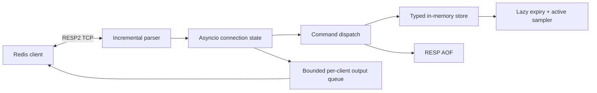

# minikv

**A tiny Redis-compatible key-value server for learning how the wire protocol, event loops, expiry, and persistence fit together.** minikv is a Python 3.12 asyncio project with a standard-library-only runtime and a redis-py-friendly RESP2 interface.

```sh
python -m venv .venv
.venv/bin/pip install -e '.[dev]'
.venv/bin/python -m minikv --appendfsync everysec
redis-cli -p 6380 ping
```

## Supported commands

| Area | Commands |
|---|---|
| Connection | `PING`, `ECHO` |
| Strings | `SET` (`EX`, `PX`, `NX`, `XX`), `GET`, `DEL`, `EXISTS`, `INCR`, `DECR`, `INCRBY` |
| Expiration | `EXPIRE`, `PEXPIRE`, `PEXPIREAT`, `TTL`, `PTTL`, `PERSIST` |
| Lists | `LPUSH`, `RPUSH`, `LPOP`, `RPOP`, `LRANGE`, `LLEN` |
| Pub/sub | `SUBSCRIBE`, `UNSUBSCRIBE`, `PUBLISH`, subscribed-mode `PING` |
| Transactions / info | `MULTI`, `EXEC`, `DISCARD`, `INFO`, `DBSIZE`, `BGREWRITEAOF` |

RESP2 is the supported wire protocol. Pattern subscriptions and RESP3 negotiation are not implemented.

## Architecture



One asyncio event loop owns the store and runs command handlers synchronously. Each command therefore completes without another client interleaving in the middle; `EXEC` applies its queued commands as one uninterrupted event-loop turn. This gives simple in-process atomicity, not isolation from process failure partway through persistence.

Expiration is checked lazily on key access and by an active task that samples expiring keys every 100 ms. The AOF records successful mutations as RESP commands, stores relative expirations as absolute timestamps, replays at startup, and supports atomic `BGREWRITEAOF` compaction.

`--appendfsync always` syncs every appended write, `everysec` syncs from a background task, and `no` leaves syncing to the operating system. Graceful SIGTERM flushes the AOF. The default log is `appendonly.aof` in the current directory.

Each connection has a bounded outbound queue. A client that cannot drain its queue is disconnected when the queue fills; this keeps a slow subscriber from holding up other clients.

## Performance

The current machine-specific comparison is in [docs/benchmarks.md](docs/benchmarks.md); raw values and host metadata are in [bench/results.json](bench/results.json). `bench/run.sh` runs the same `redis-benchmark` workload against minikv and Redis on the current machine. This single run is mixed at pipeline depth 1 and favors Redis at pipeline depth 16. Redis is optimized native code, while minikv incurs Python parsing, dispatch, and asyncio stream work; writes also append RESP to the AOF. Benchmark configuration and machine details are included with the results; do not compare runs from different hosts as if they were controlled measurements.

The [interactive RESP explainer](site/index.html) renders command bytes and parse steps in the browser and plots the recorded benchmark data.

## Development

```sh
.venv/bin/ruff check minikv tests
.venv/bin/mypy minikv
.venv/bin/pytest -q
```

Install Redis CLI tools for the direct smoke check. Integration tests use redis-py, including concurrent increments, pub/sub fan-out, transactions, and process-kill AOF recovery.

## Limitations

- No clustering, replication, Sentinel, RDB snapshots, or multi-database support.
- Most Redis data types and many commands/options are not implemented.
- No ACLs, TLS, authentication, Lua, scripting, streams, sorted sets, sets, hashes, or bit operations.
- RESP3 and pattern pub/sub are not implemented.
- The store is in memory and single-process; it is a showcase, not a production Redis replacement.
