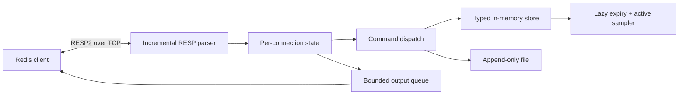

<div align="center">

# ⚡ minikv

**A Redis-compatible server built from scratch in ~1,200 lines of pure-stdlib Python.**

Real RESP2 wire protocol · 30 commands · TTL expiry · pub/sub · transactions · crash-safe AOF persistence

[](https://github.com/varunsahu258/minikv/actions/workflows/ci.yml)


</div>

---

## Why this exists

Everyone uses Redis; few people have built the pieces behind it. minikv is a learning-grade implementation you can read in one sitting, and it talks to **real clients**: `redis-cli`, `redis-py` and `redis-benchmark` work against it unchanged.

```bash
python -m venv .venv && .venv/bin/pip install -e '.[dev]'
.venv/bin/python -m minikv --appendfsync everysec
redis-cli -p 6380 ping        # → PONG
```

```text
127.0.0.1:6380> SET session:42 alice EX 30
OK
127.0.0.1:6380> INCR visits
(integer) 1
127.0.0.1:6380> MULTI
OK
127.0.0.1:6380(TX)> LPUSH queue job1
QUEUED
127.0.0.1:6380(TX)> EXEC
1) (integer) 1
```

## What it implements

| Area | Commands |
| --- | --- |
| Connection | `PING` `ECHO` |
| Strings | `SET` (`EX` `PX` `NX` `XX`) `GET` `DEL` `EXISTS` `INCR` `DECR` `INCRBY` |
| Expiration | `EXPIRE` `PEXPIRE` `PEXPIREAT` `TTL` `PTTL` `PERSIST` |
| Lists | `LPUSH` `RPUSH` `LPOP` `RPOP` `LRANGE` `LLEN` |
| Pub/Sub | `SUBSCRIBE` `UNSUBSCRIBE` `PUBLISH` |
| Transactions / admin | `MULTI` `EXEC` `DISCARD` `INFO` `DBSIZE` `BGREWRITEAOF` |

## How it works



**Single-threaded by design.** One asyncio event loop owns the store and command handlers never `await` mid-mutation, so no command can be interleaved by another client. `EXEC` runs its queued commands as one uninterrupted loop turn. That gives atomicity with zero locks.

**Two-layer expiry.** Every key access checks its deadline (lazy), and a 100 ms background sampler reaps keys nobody reads (active). Time is injected, so expiry tests are deterministic.

**Crash-safe persistence (AOF).**

| `--appendfsync` | Behavior |
| --- | --- |
| `always` | fsync after every write; safest |
| `everysec` | background fsync once per second; the classic trade-off |
| `no` | leave it to the OS; fastest |

Relative TTLs are stored as absolute timestamps so downtime counts. A torn final command is ignored on replay. `BGREWRITEAOF` compacts the log by writing a temp file, fsyncing, and atomically replacing the old one.

**Slow-consumer protection.** Each client has a bounded output queue; one that cannot keep up is disconnected so a stalled subscriber can never block publishers or exhaust memory.

Design rationale: [DECISIONS.md](DECISIONS.md).

## Performance, measured and profiled

The interesting part is not the headline number but the **profile-driven optimization**.

Profile of 200,000 pipelined requests (cProfile, so use for *where* time goes, not absolute speed):

| Metric | Before | After |
| --- | ---: | ---: |
| Total profiled time | 14.94 s | 7.45 s |
| `AOF.append` cumulative | 7.52 s | **1.15 s** |
| Response sender cumulative | 0.94 s | 0.35 s |

Three fixes found by reading the profile: **keep the AOF file handle open** (it was reopening 150,000 times), compact the parser buffer once per chunk instead of per frame, and batch queued replies into a single transport write.

| Operation | Pipeline | Before req/s | After req/s | Change |
| --- | ---: | ---: | ---: | ---: |
| SET | 16 | 23,373 | 114,220 | **+389%** |
| INCR | 16 | 24,041 | 129,199 | **+437%** |
| GET | 16 | 119,617 | 157,729 | +32% |
| SET | 1 | 13,766 | 29,678 | +116% |

### Against real Redis (read the caveats)

Same `redis-benchmark` workload, Apple M2, Redis 7.4 in Docker:

- At pipeline depth 1, minikv *appeared* faster on SET/GET/INCR. That is a measurement artifact: Redis ran in Docker, minikv natively, and fixed network costs dominate at low request rates. It is **not** evidence that Python beats Redis.
- At pipeline depth 16, Redis wins everywhere (about 1.9x on GET up to 16x on LPUSH), exactly as expected from native code vs. Python parsing and asyncio.
- LPUSH is weak because lists are Python lists inserting at index 0 (O(n)). A production implementation would use a deque or linked structure. Known trade-off, documented.

All numbers are single runs on one machine, with raw JSON and host metadata in [`bench/`](bench/) and [docs/benchmarks.md](docs/benchmarks.md). Reproduce with `bench/run.sh`.

## Testing

```bash
.venv/bin/ruff check minikv tests
.venv/bin/mypy minikv          # strict
.venv/bin/pytest -q
```

- **Protocol tests** for the incremental parser (split packets, partial frames).
- **Fuzz test**: one minute of random bytes into the parser, which must never crash.
- **AOF tests** including truncated-file replay.
- **Integration tests with redis-py**: concurrent `INCR`, pub/sub fan-out, transactions, and **kill the process and recover from the AOF**.

## Interactive explainer

Open [`site/index.html`](site/index.html) to see command bytes and parser steps rendered in the browser, alongside the recorded benchmark data.

## Limitations

A showcase, not a Redis replacement. No clustering, replication, RDB snapshots, ACLs, TLS, Lua, streams, sets, hashes, sorted sets, RESP3 or pattern subscriptions. Single process; a CPU-heavy command blocks every client.

## Roadmap

- [ ] Hashes and sets
- [ ] Deque-backed lists for O(1) head insertion
- [ ] RDB-style snapshots
- [ ] `SCAN` and key eviction (LRU)
- [ ] Pattern pub/sub (`PSUBSCRIBE`)

## License

MIT. See [LICENSE](LICENSE).
